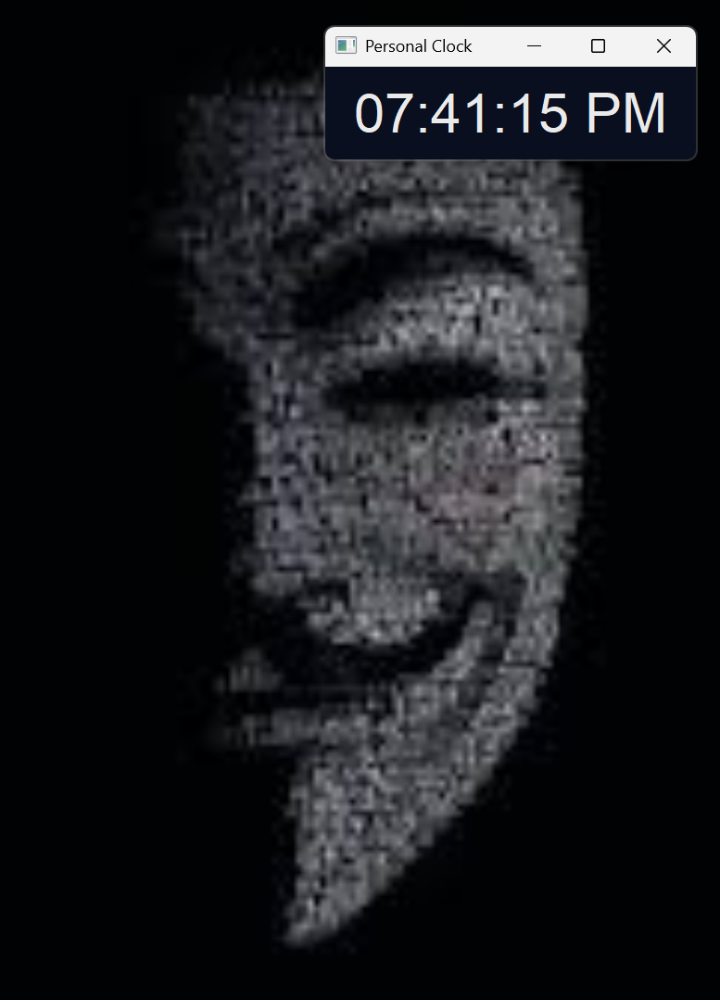

# 🕒 Digital Clock

**A sleek and modern digital clock application built with Python and PyQt5, showcasing real-time time display in a minimalist interface.**
# ⭐ First Star the repo



## ✨ Features

- **Real-Time Display**: Continuously updates to show the current time in HH:MM:SS AM/PM format.
- **Minimalist UI**: Clean, dark-themed interface with large, readable fonts.
- **Customizable Styling**: Easily adjustable colors, fonts, and layout via PyQt5 stylesheets.
- **Lightweight**: Simple, efficient code with no external dependencies beyond PyQt5.

## 🛠 Technologies Used

- **Python**: Core programming language for logic and application structure.
- **PyQt5**: GUI framework for creating the desktop window and handling user interface elements.

## 🚀 How to Run

### Option 1: Standalone Executable (Recommended for End Users)
For the easiest experience, download and run the standalone executable:

1. Download `Digital_Clock.exe` from the [Releases](https://github.com/samkiel488/digitalclock/releases) section.
2. Double-click `Digital_Clock.exe` to launch the application.
3. No installation required - it includes all dependencies!

### Option 2: Run from Source Code

#### Prerequisites
- Python 3.x installed on your system.
- PyQt5 library: Install via pip if not already available.

#### Installation
1. Clone this repository:
   ```bash
   git clone https://github.com/samkiel488/digitalclock.git
   cd digitalclock
   ```

2. Install dependencies:
   ```bash
   pip install PyQt5
   ```

#### Running the Application
Execute the main script:
```bash
python Digital_Clock.py
```

The digital clock window will appear, displaying the current time.


## 👨‍💻 Author

**Samuel Ezekiel (Dev Samkiel)**  
*Software Engineer | Full Stack Developer | Cyber Security Enthusiast*  

**SAMKIEL** — *Digitalizing The World*  

- 🌐 **Website**: [samkiel.dev](https://samkiel.dev)
- 📧 **Email**: samkiel.dev@gmail.com
- 🐙 **GitHub**: [github.com/samkiel488](https://github.com/samkiel488)
- 💬 **WhatsApp**: [wa.me/+2348087357158](wa.me/+2348087357158)
- 📍 **Location**: Osun State, Nigeria

## 📄 License

This project is open-source and available under the [MIT License](LICENSE).

---

*#Samkiel #SamkielDev #Python #PyQt5 #DigitalClock #OpenSource #DeveloperLife #SoftwareEngineering #SamuelEzekiel*
